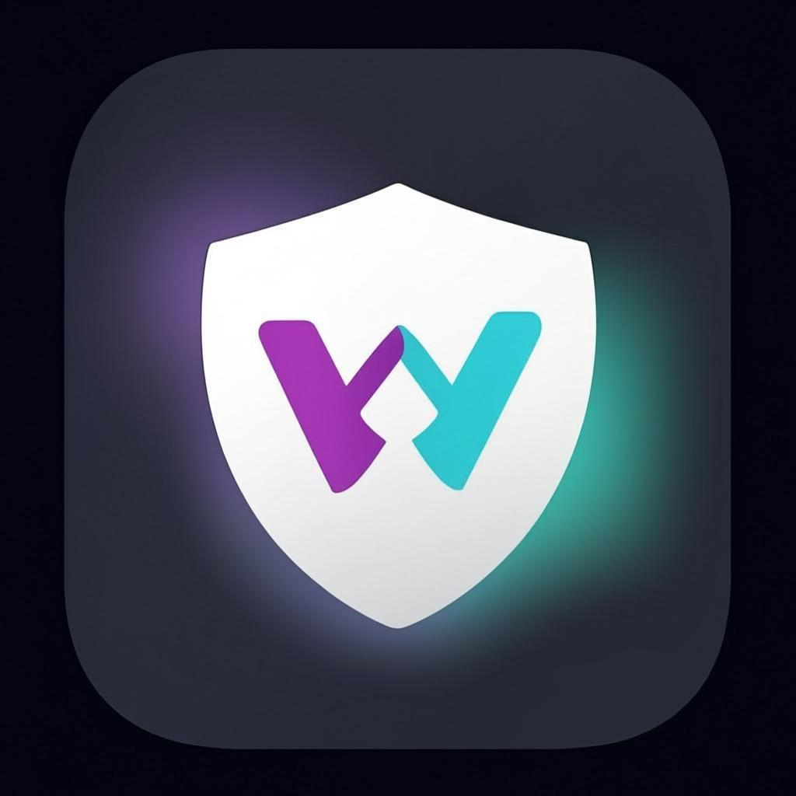

# 🤍 WhiteCheats

**Белые скрипты для Roblox — польза без вреда**

чит-компанья с белой совестью: никакой деструктивщины, только честные client-side утилиты

### ✦ Что мы делаем

| скрипт | статус | описание |
| --- | --- | --- |
| 🧭 Loader | ✅ готов | авто-загрузчик карточек скриптов, glass UI, темы |
| 👁 XP View | 🕓 скоро | информатор опыта без вмешательства в игру |
| 🧍 Local NPC | 🕓 фаза 2 | визуальный NPC для тестов урона, кастомизация всего |

### 🎨 Style

**Glass** • темы: `dark` / `white` / `system` / `auto`

### ⛔ Что мы НЕ делаем

Fly • Noclip • Fling • Kill-эксплойты — anything, что вредит игрокам или игре

### 🗺 Plan

- [x] фаза 1 — аккаунт, репозиторий `scripts`, loader
- [ ] фаза 2 — первый скрипт **Local NPC**
- [ ] фаза 3 — сайт на Vercel

📮 Контакты: Issues в [репозитории scripts](https://github.com/official-ids/scripts).

